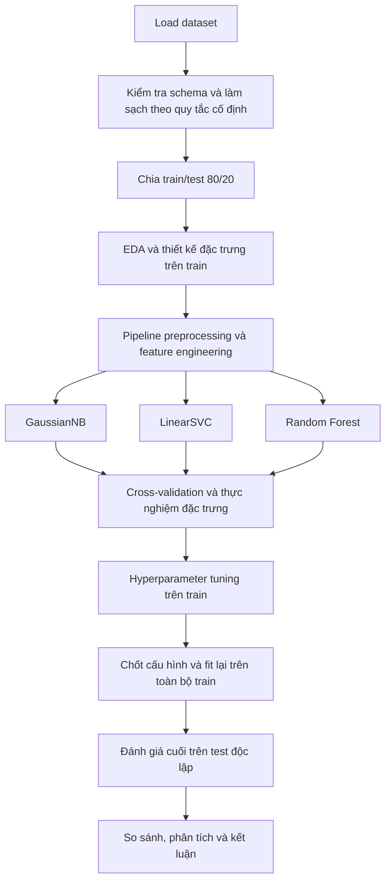

# Hotel Booking Cancellation Prediction

## 1. Giới thiệu dự án

Dự án môn Học máy cơ bản nhằm dự đoán khả năng khách hàng hủy đặt phòng khách sạn bằng ba thuật toán học có giám sát:

- Gaussian Naive Bayes (GaussianNB).
- Support Vector Machine (LinearSVC).
- Random Forest (RandomForestClassifier).

Mục tiêu: phân tích dữ liệu, xây dựng đặc trưng, huấn luyện, tối ưu siêu tham số và so sánh hiệu quả ba mô hình bằng thực nghiệm.

**Phạm vi:** Chỉ xây dựng backend Machine Learning, không xây dựng website hoặc app demo. Thời gian triển khai dự kiến: 2 ngày.

## 2. Dataset

- Nguồn: [Hotel Booking Demand – Kaggle](https://www.kaggle.com/datasets/jessemostipak/hotel-booking-demand).
- File: `dataset/hotel_bookings.csv`.
- Kích thước bộ dữ liệu gốc: 119.390 bản ghi, 32 cột.
- Biến mục tiêu: `is_canceled` (0: không hủy; 1: hủy).
- Bài toán: phân lớp nhị phân.

Mục tiêu dự đoán tại thời điểm đặt phòng, chỉ sử dụng thông tin khả dụng tại thời điểm đó. Loại bỏ `reservation_status`, `reservation_status_date` và rà soát các trường phát sinh sau khi đặt phòng như `assigned_room_type`, `booking_changes`, `days_in_waiting_list` trước khi đưa vào mô hình. Nếu không xác nhận được thời điểm khả dụng thì loại khỏi đầu vào.

## 3. Phân công công việc

### 3.1. Đức — EDA, Preprocessing, Naive Bayes và SVM

- [ ] Khảo sát dữ liệu, kiểu dữ liệu, phân phối nhãn và các đặc trưng.
- [ ] Trực quan hóa dữ liệu; kiểm tra missing values, duplicates và outliers.
- [ ] Xây dựng quy tắc làm sạch; không tự động xóa các bản ghi giống nhau nếu chưa xác định chúng là lỗi trùng lặp.
- [ ] Xây dựng hàm chia train/test và cấu hình dùng chung.
- [ ] Xây dựng preprocessing pipeline: imputation, encoding và scaling phù hợp từng mô hình.
- [ ] Huấn luyện GaussianNB và LinearSVC baseline.
- [ ] Thực nghiệm hai mô hình với đặc trưng mới do Giang cung cấp.
- [ ] Tuning hai mô hình bằng cross-validation; lưu pipeline và kết quả.
- [ ] Phân tích kết quả, hạn chế và lỗi dự đoán của hai mô hình.
- [ ] Kiểm tra code, cập nhật GitHub và viết phần báo cáo phụ trách.

**File phụ trách:**

```text
src/config.py
src/preprocessing.py
src/naive_bayes.py
src/svm_model.py
notebooks/01_Preprocessing_EDA.ipynb
notebooks/03_Naive_Bayes_SVM.ipynb
```

### 3.2. Giang — Feature Engineering, Random Forest và Evaluation

- [ ] Rà soát đặc trưng gây data leakage cùng Đức.
- [ ] Phân tích và xây dựng đặc trưng mới trong module dùng chung.
- [ ] Thử nghiệm lựa chọn đặc trưng trên tập train bằng phương pháp phù hợp (ví dụ SelectPercentile với mutual information hoặc ANOVA F-test).
- [ ] Huấn luyện Random Forest baseline và các phiên bản cải tiến.
- [ ] Tuning Random Forest bằng cross-validation; lưu pipeline và kết quả.
- [ ] Phân tích Feature Importance và lỗi dự đoán của Random Forest.
- [ ] Xây dựng hàm đánh giá chung cho ba mô hình.
- [ ] Tổng hợp metrics, confusion matrix, ROC curve và biểu đồ so sánh.
- [ ] Tích hợp backend, xây dựng lệnh chạy toàn bộ mô hình.
- [ ] Kiểm tra code, cập nhật GitHub và viết phần báo cáo phụ trách.

**File phụ trách:**

```text
src/feature_engineering.py
src/random_forest.py
src/evaluation.py
src/train_all.py
notebooks/02_Feature_Engineering.ipynb
notebooks/04_Random_Forest.ipynb
notebooks/05_Model_Comparison.ipynb
```

### 3.3. Trách nhiệm chung

- [ ] Thống nhất schema dữ liệu, thời điểm dự đoán, tập train/test, CV folds và giao diện giữa các module trước khi lập trình.
- [ ] Kiểm tra chéo code, kết quả và nguy cơ data leakage.
- [ ] Hoàn thiện `requirements.txt`, `.gitignore`, README và hướng dẫn chạy.
- [ ] Chạy thử toàn bộ backend từ đầu đến cuối; chuẩn bị phiên bản nộp/demo không chứa comment theo yêu cầu giảng viên.
- [ ] Hoàn thiện báo cáo, slide và ôn tập vấn đáp cả ba thuật toán.

## 4. Tiến độ thực hiện (2 ngày)

| Thời gian | Đức | Giang |
|---|---|---|
| Ngày 1, 08:00–09:00 | Khảo sát dataset, thống nhất schema | Rà soát đặc trưng, thống nhất giao diện module |
| 09:00–12:00 | EDA, làm sạch, split, preprocessing | Feature Engineering, xây dựng evaluation |
| 13:00–17:00 | Naive Bayes và LinearSVC baseline | Random Forest baseline, kiểm tra metrics |
| 17:00–18:00 | Kiểm tra, commit, tích hợp preprocessing | Kiểm tra, commit, tích hợp features và evaluation |
| Ngày 2, 08:00–12:00 | Thử đặc trưng mới, tuning NB/SVM | Thử đặc trưng mới, tuning RF, lựa chọn đặc trưng |
| 13:00–14:30 | Chốt cấu hình theo CV, đánh giá cuối | Chốt cấu hình theo CV, đánh giá cuối |
| 14:30–16:00 | Phân tích kết quả NB/SVM | Tổng hợp metrics, biểu đồ, phân tích lỗi |
| 16:00–18:00 | Kiểm tra tích hợp, báo cáo | Chạy toàn bộ backend, báo cáo, merge |

Ưu tiên hoàn thành cả ba baseline trước. Nếu thiếu thời gian, giảm số cấu hình tuning và số thử nghiệm phụ; không bỏ qua kiểm tra leakage hoặc đánh giá cuối trên test set.

## 5. Quy trình Machine Learning



### 5.1. Cấu hình dùng chung

```python
RANDOM_STATE = 42
TEST_SIZE = 0.2
CV_FOLDS = 3
TARGET = "is_canceled"
SCORING = "f1"
DROP_COLUMNS = ["reservation_status", "reservation_status_date"]
```

- Chia dữ liệu một lần theo quy trình chung, sử dụng `stratify=y` và `random_state=42`.
- Dùng `StratifiedKFold(n_splits=3, shuffle=True, random_state=42)` cho cả ba mô hình.
- Không chia lại dữ liệu riêng trong từng notebook.
- Các thao tác học tham số (imputation, encoding, scaling, feature selection) phải nằm trong `Pipeline`/`ColumnTransformer` và được fit riêng trên phần train của từng fold.
- Không dùng test set để lựa chọn đặc trưng, tham số hoặc ngưỡng dự đoán.
- Các mô hình dùng cùng bản ghi và cùng bộ đặc trưng gốc ở mỗi thực nghiệm; được phép biến đổi dữ liệu khác nhau theo yêu cầu thuật toán.
- Chia ngẫu nhiên có phân tầng là thiết kế thực nghiệm của đồ án; không khẳng định kết quả phản ánh chính xác hiệu năng trên các booking tương lai. Có thể nghiên cứu chia theo thời gian nếu còn thời gian.

### 5.2. Giao diện dữ liệu và module

Thống nhất các hàm dự kiến trước khi code:

| Module | Hàm dự kiến | Chức năng |
|---|---|---|
| `preprocessing.py` | `load_and_split(path)` | Trả về `X_train, X_test, y_train, y_test` chưa fit preprocessing |
| `preprocessing.py` | `build_preprocessor(model_name, X_train)` | Tạo transformer chưa fit, xác định schema từ train |
| `feature_engineering.py` | `add_features(X)` | Tạo đặc trưng theo quy tắc cố định, không dùng nhãn |
| Các module mô hình | `build_model(...)` | Tạo pipeline chưa fit |
| `evaluation.py` | `evaluate_model(model, X, y)` | Trả về metrics và hỗ trợ lưu biểu đồ |
| `train_all.py` | `main()` | Điều phối thực nghiệm, tuning và đánh giá |

Các hàm tạo đặc trưng có học tham số hoặc lựa chọn đặc trưng phải được triển khai dưới dạng transformer trong pipeline. Cả hai thành viên thống nhất chữ ký hàm cuối cùng trước khi tích hợp.

### 5.3. Preprocessing theo mô hình

| Bước | GaussianNB | LinearSVC | Random Forest |
|---|---|---|---|
| Imputation | Có | Có | Có |
| One-Hot Encoding | Có | Có | Có |
| StandardScaler cho biến số | Không bắt buộc | Có | Không cần |
| Feature Engineering | Có | Có | Có |
| Định dạng đầu vào | Dense | Sparse hoặc dense | Sparse hoặc dense |

Dùng `OneHotEncoder(handle_unknown="ignore")`. Với GaussianNB, cần đầu ra dense và kiểm tra bộ nhớ; có thể giới hạn nhóm danh mục hiếm theo quy tắc học trên train. GaussianNB giả định phân phối Gaussian có điều kiện và độc lập có điều kiện giữa các đặc trưng; dữ liệu one-hot không hoàn toàn thỏa giả định này, cần nêu hạn chế trong báo cáo.

## 6. Feature Engineering

Giang phụ trách module chung; Đức tích hợp vào pipeline NB và SVM.

| Đặc trưng mới | Cách xây dựng |
|---|---|
| `total_guests` | `adults + children + babies` |
| `total_nights` | `stays_in_weekend_nights + stays_in_week_nights` |
| `estimated_cost` | `adr * total_nights` (nếu ADR khả dụng tại thời điểm dự đoán) |
| `has_children` | `children + babies > 0` |
| `previous_cancel_rate` | `previous_cancellations / (previous_cancellations + previous_bookings_not_canceled)` |
| `lead_time_group` | Phân nhóm lead_time theo ngưỡng cố định hoặc học trên train |
| `is_family` | Có người lớn và trẻ em hoặc em bé |

Xử lý mẫu số bằng 0 bằng quy ước tỷ lệ bằng 0 và có thể thêm cờ chưa có lịch sử. Xử lý missing values của các cột nguồn nhất quán trước khi tính đặc trưng. Không mặc định mọi đặc trưng mới đều có ích; kiểm chứng bằng CV.

Feature Selection là thử nghiệm riêng: so sánh với bộ đặc trưng đầy đủ, chỉ fit bộ chọn đặc trưng trong từng fold. Feature Importance của Random Forest dùng để phân tích, không được diễn giải thành quan hệ nhân quả.

## 7. Thiết kế thực nghiệm

| Mã | Nội dung | Mô hình |
|---|---|---|
| TN1 | Baseline với đặc trưng gốc đã làm sạch | Cả 3 |
| TN2 | Bổ sung đặc trưng mới, giữ nguyên tham số baseline | Cả 3 |
| TN3 | Thử lựa chọn đặc trưng, giữ nguyên tham số baseline | Cả 3 nếu đủ thời gian; ưu tiên Random Forest |
| TN4 | Tuning trên cấu hình đặc trưng được chọn theo CV | Cả 3 |
| TN5 | Đánh giá cuối các cấu hình đã chốt trên test | Cả 3 |

So sánh TN1–TN4 bằng cùng CV folds, báo cáo F1 trung bình và độ lệch chuẩn. Chốt cấu hình tốt nhất của từng thuật toán và mô hình ưu tiên theo CV trước khi xem test. Có thể đánh giá cả baseline và tuned trên test trong đợt đánh giá cuối đã định trước, không quay lại tuning dựa trên test.

## 8. Hyperparameter Tuning

Sử dụng GridSearchCV cho GaussianNB và LinearSVC; RandomizedSearchCV cho Random Forest. Chỉ số tối ưu: F1-score của lớp hủy phòng (`pos_label=1`).

| Mô hình | Tham số | Giá trị đề xuất |
|---|---|---|
| GaussianNB | `var_smoothing` | 1e-7, 1e-8, 1e-9, 1e-10 |
| LinearSVC | `C` | 0.01, 0.1, 1, 10 |
| Random Forest | `n_estimators` | 50, 100, 200 |
| Random Forest | `max_depth` | 10, 20, None |
| Random Forest | `min_samples_split` | 2, 5, 10 |
| Random Forest | `min_samples_leaf` | 1, 2, 4 |

Random Forest: thử tối đa 10 cấu hình ngẫu nhiên, `random_state=42`. Khi dùng pipeline có bước tên `model`, tham số tuning có tiền tố `model__`, ví dụ `model__C`.

LinearSVC được chọn để tiết kiệm thời gian trên dataset lớn. Có thể thử SVC kernel RBF như thực nghiệm phụ nếu đủ tài nguyên; không so sánh trực tiếp kết quả trên các test set khác nhau. Theo dõi cảnh báo hội tụ của LinearSVC và điều chỉnh `max_iter` nếu cần.

## 9. Đánh giá mô hình

- Accuracy: tỷ lệ dự đoán đúng.
- Precision: tỷ lệ booking thực sự hủy trong số booking được dự đoán hủy.
- Recall: tỷ lệ booking hủy được phát hiện.
- F1-score: trung bình điều hòa Precision và Recall; chỉ số chính.
- ROC-AUC: khả năng phân biệt hai lớp, dùng `predict_proba()[:, 1]` với NB/RF và `decision_function()` với LinearSVC.
- Confusion Matrix: TN, FP, FN, TP; thống nhất thứ tự nhãn `[0, 1]`.
- Thời gian huấn luyện và dự đoán: đo trên cùng môi trường nếu dùng để so sánh tốc độ.

### 9.1. Kết quả Cross-validation (chờ thực nghiệm)

| Mô hình | Baseline F1 | Feature Engineering F1 | Feature Selection F1 | Tuned F1 |
|---|---|---|---|---|
| Naive Bayes | — | — | — | — |
| SVM | — | — | — | — |
| Random Forest | — | — | — | — |

### 9.2. Kết quả test cuối cùng (chờ thực nghiệm)

| Mô hình | Accuracy | Precision | Recall | F1 | ROC-AUC |
|---|---|---|---|---|---|
| Naive Bayes | — | — | — | — | — |
| SVM | — | — | — | — | — |
| Random Forest | — | — | — | — | — |

Lưu kết quả CV vào `results/cv_metrics.csv`, kết quả test vào `results/metrics.csv`. Ghi rõ model, experiment, feature set, tham số, metrics và thời gian. Không tự đặt số liệu hoặc chọn trước thuật toán chiến thắng.

## 10. Cấu trúc project dự kiến

```text
Hotel_Booking_ML/
├── dataset/
│   └── hotel_bookings.csv
├── notebooks/
│   ├── 01_Preprocessing_EDA.ipynb
│   ├── 02_Feature_Engineering.ipynb
│   ├── 03_Naive_Bayes_SVM.ipynb
│   ├── 04_Random_Forest.ipynb
│   └── 05_Model_Comparison.ipynb
├── src/
│   ├── __init__.py
│   ├── config.py
│   ├── preprocessing.py
│   ├── feature_engineering.py
│   ├── naive_bayes.py
│   ├── svm_model.py
│   ├── random_forest.py
│   ├── evaluation.py
│   └── train_all.py
├── models/
│   ├── naive_bayes.joblib
│   ├── svm.joblib
│   └── random_forest.joblib
├── results/
│   ├── cv_metrics.csv
│   ├── metrics.csv
│   └── figures/
│       ├── confusion_matrix_nb.png
│       ├── confusion_matrix_svm.png
│       ├── confusion_matrix_rf.png
│       ├── roc_comparison.png
│       ├── feature_importance.png
│       └── model_comparison.png
├── requirements.txt
├── .gitignore
└── README.md
```

`src/` chứa logic backend; notebook gọi lại các module để tránh lặp code. Lưu toàn bộ pipeline đã fit (bao gồm preprocessing) bằng Joblib, không chỉ lưu classifier. Các file kết quả và mô hình sẽ được tạo sau khi chạy thực nghiệm.

## 11. Môi trường và hướng dẫn chạy

- Python 3.11 (đề xuất), Google Colab hoặc môi trường Python local.
- Thư viện: pandas, numpy, scikit-learn, matplotlib, seaborn, joblib, jupyter.
- Hai thành viên thống nhất và ghi phiên bản thư viện thực tế đã kiểm thử vào `requirements.txt`.

Sau khi clone repository và tải dataset từ nguồn ở mục 2, đặt CSV vào `dataset/`, mở terminal tại thư mục gốc project:

```bash
python -m pip install -r requirements.txt
python -m src.train_all
```

Hoặc mở các notebook theo thứ tự 01–05 sau khi hoàn thành các module trong `src/`. Lệnh chạy trên là giao diện dự kiến, sẽ được kiểm thử sau khi code hoàn tất.

## 12. Quy định làm việc trên GitHub

| Branch | Người phụ trách | Nội dung |
|---|---|---|
| `main` | Cả hai | Phiên bản đã kiểm tra và tích hợp |
| `dev-duc` | Đức | Preprocessing, NB, SVM |
| `dev-giang` | Giang | Feature Engineering, RF, Evaluation, Integration |

- Repository dùng chung; mỗi thành viên sử dụng tài khoản GitHub riêng.
- Làm việc trên branch cá nhân, commit theo từng chức năng và push thường xuyên.
- Tích hợp sớm các module dùng chung (config, split, features, evaluation) để không chặn tiến độ của người còn lại.
- Đồng bộ thay đổi từ `main` trước khi tiếp tục tích hợp; tạo Pull Request và kiểm tra chéo trước khi merge.
- Không sửa đồng thời cùng notebook hoặc file do người khác phụ trách nếu chưa thống nhất.
- Dataset và mô hình lớn lưu trên Google Drive chung hoặc tải từ nguồn gốc; không commit file lớn, môi trường ảo, cache hay thông tin đăng nhập.
- Commit kết quả thực nghiệm nhỏ, biểu đồ và cấu hình để có thể tái lập kết quả.

Ví dụ commit:

```text
feat: implement shared preprocessing pipeline
feat: train Gaussian Naive Bayes and LinearSVC
feat: add booking feature engineering
feat: implement Random Forest training
feat: add shared evaluation metrics
fix: prevent data leakage during cross-validation
```

## 13. Tiêu chí hoàn thành

- [ ] Cả ba mô hình chạy được trên cùng tập train/test.
- [ ] Có EDA, preprocessing và thực nghiệm Feature Engineering.
- [ ] Có baseline, tuning và kết quả CV của cả ba thuật toán.
- [ ] Không dùng test set để tuning hoặc lựa chọn đặc trưng.
- [ ] Có metrics, confusion matrix, biểu đồ và phân tích lỗi.
- [ ] Có kết quả đánh giá ảnh hưởng của đặc trưng và siêu tham số.
- [ ] Lưu pipeline đã huấn luyện và kiểm tra khả năng tải lại.
- [ ] Chạy được toàn bộ backend theo hướng dẫn trên máy chuẩn bị đi thi.
- [ ] Hai thành viên kiểm tra chéo code, hiểu phần đóng góp của mình và nguyên lý cả ba mô hình.
- [ ] Hoàn thiện báo cáo, slide và phiên bản code nộp/demo.

**Trạng thái:** Kế hoạch triển khai. Kết quả thực nghiệm, phiên bản thư viện và hướng dẫn chạy sẽ được cập nhật sau khi kiểm thử thực tế.
